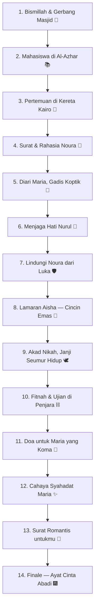

# Rencana Implementasi: Web Animasi Interaktif "Ayat-ayat Cinta 🕌"

Dokumen ini merancang proyek web baru interaktif bertema **Islami-Arab Romantis (Kairo & Al-Azhar)** terinspirasi novel *Ayat-ayat Cinta* karya **Habiburrahman El Shirazy**, dengan alur **14 Babak Penuh Mini-Game**, **Aset Arab (SVG Kaligrafi & GIF)**, **Musik dari Luar (Archive.org)**, dan **Optimasi Mode HP (Mobile-First)**.

---

## 🎯 1. Konsep & Gambaran Umum
- **Folder Proyek**: `/Users/andri.dev.code/Coding/Html/ayat-ayat-Cinta/`
- **Tema**: Cinta & iman di Kairo — kisah Fahri (mahasiswa Indonesia di Al-Azhar), Aisha, Maria, Nurul, Noura. Nuansa naskah kuno, kubah masjid, lentera, bulan sabit, kaligrafi emas.
- **Kata-kata**: 14+ kutipan romantis **orisinal** terinspirasi novel (bikin baper), diselipi frasa Arab (*habibi, roohi, bismillah, insya Allah*).
- **File**: `index.html`, `style.css`, `script.js`, `PLAN.md`, `assets/`
- **Mobile-first**: viewport-fit, safe-area, touch target ≥48px.

---

## 🎨 2. Palet Warna
| Nama | Hex | Peran visual |
| :--- | :--- | :--- |
| Malam Kairo | `#0a1128` | Latar utama langit malam |
| Malam Dalam | `#060b1d` | Kedalaman gradasi |
| Emerald Masjid | `#0d3b2e` & `#14532d` | Aksen kubah & gerbang |
| Gold Kaligrafi | `#d4af37` & `#f0c75e` | Ornamen, judul, sabit |
| Pearl Naskah | `#f6efdd` & `#fff8ea` | Kartu naskah & teks |
| Rose Cinta | `#e0526a` | Aksen hati & kasih |
| Night Violet | `#1b1a3a` | Aksen malam romantis |

- **Atmosfer**: partikel lentera & bintang melayang (`#ambient-canvas`), pendar emas lembut, kartu naskah glassmorphism berwarna pearl.

---

## 🎵 3. Musik dari Luar (Sudah Diuji: CORS + Range OK)

### 🎶 A. Musik Latar (URL Eksternal)
- **Utama**: `https://archive.org/download/arabic-instrumental-song/Dubai%20Dream%20Arabic.mp3`
  - Instrumental Arab syahdu ~4 menit. Respons `access-control-allow-origin: *`, range `206` terverifikasi.
- **Cadangan lokal**: file yang sama diunduh ke `assets/dubai_dream_arabic.mp3` (di-probing via `fetch(..., {method:'HEAD'})`).
- **Cadangan terakhir**: synth Web Audio bertema maqam/kord arab (ringan, tanpa unduhan).

### 🔊 B. Efek Suara (Web Audio API SFX)
- Denting chime emas, ketukan pintu gerbang, gemuruh doa lembut, lonceng akad — semua di-generate via Web Audio (ringan & jernih).

---

## 🖼️ 4. Aset Arab: SVG & GIF

### 🕌 A. SVG Inline (Dibuat Sendiri, Bertema Arab)
1. **Gerbang Masjid & Kubah** — siluet kubah berars, gerbang bertingkat, menara.
2. **Bulan Sabit & Bintang** — ornamen langit Kairo.
3. **Lentera Ramadhan/Fanoos** — lentera emas berayun bercahaya.
4. **Pola Arabesque** — simetris geometris Islami sebagai latar pola.
5. **Cincin Akad & Gulungan Surat** — properti babak lamaran & surat.
6. **Pena Kaligrafi & Al-Qur'an** — untuk babak diari & ilmu.
7. **Rantai/Bilah Penjara** — untuk babak ujian (dengan celah cahaya).
8. **Partikel Hati Emas** — untuk transisi & keberhasilan.

### 🖼️ B. GIF Arab (Dari Luar — Giphy, Diunduh ke `assets/`)
Di-scrape dari halaman Giphy (kata kunci: `arabic calligraphy`, `bismillah`, `mosque night`, `ramadan lantern`, `islamic pattern`) lalu diunduh lokal:
- `assets/gif-kaligrafi.gif` — kaligrafi Arab bergerak
- `assets/gif-bismillah.gif` — bismillah berpendar
- `assets/gif-masjid.gif` — masjid malam hari
- `assets/gif-lentera.gif` — lentera Ramadhan berayun
- **Fallback**: bila GIF gagal dimuat, elemen memakai SVG statis yang sudah disediakan.

### ✨ C. GIF Kaligrafi Kustom (Opsional)
Dirender via **Chrome for Testing headless** (font *Amiri/Aref Ruqaa*) → frame PNG → digabung jadi GIF dengan PIL, bila diperlukan untuk kalimat pembuka.

---

## 📱 5. Standar Responsif Mode HP

| Fitur Mobile | Implementasi Teknis |
| :--- | :--- |
| **Viewport HP** | `width=device-width, initial-scale=1.0, maximum-scale=1.0, user-scalable=no, viewport-fit=cover` |
| **Ukuran Layar Ideal** | `#stage { max-width:414px; width:92vw; }` |
| **Safe Area Insets** | `env(safe-area-inset-top)` & `env(safe-area-inset-bottom)` |
| **Touch Optimization** | Mendukung `touchstart/touchmove/touchend` + `{passive:false}` untuk mini-game |
| **Ukuran Tombol Nyaman** | Touch target minimal **48px × 48px** |
| **Performa 60fps** | Animasi GPU CSS (`transform`/`opacity`), `backdrop-filter` untuk kartu |

---

## 🗺️ 6. Alur 14 Babak Penuh Mini-Game



### Rincian 14 Babak & Gameplay:
1. 🕌 **Bismillah & Gerbang Masjid**: Ketuk gerbang 3× untuk membuka kalimat *Bismillah* berpendar + stiker GIF bismillah.
2. 📚 **Mahasiswa di Al-Azhar**: Ketuk 5 bintang ilmu yang melayang untuk mengumpulkan hikmah.
3. 🚃 **Pertemuan di Kereta Kairo**: Geser rel kereta (slider) hingga bertemu sosok di jendela — *kata romantis Aisha*.
4. 💌 **Surat & Rahasia Noura**: Tarik/angkat gulungan surat, ketuk segel lilin untuk membuka isi.
5. 📖 **Diari Maria**: Gosok halaman diari (scratch) untuk mengungkap kalimat rahasia Maria.
6. 💎 **Menjaga Hati Nurul**: Pilih 3 permata jujur vs mengelak — kartu jawaban tampil dengan kutipan.
7. 🛡️ **Lindungi Noura**: Tahan perisai 3 detik menahan hujan nada agar Noura selamat.
8. 💍 **Lamaran Aisha**: Pasangkan 2 bagian cincin emas (drag) hingga bersinar penuh.
9. 🕊️ **Akad Nikah**: Tekan & tahan tombol "Qabiltu" 2 detik — lonceng akad + konfeti emas.
10. ⛓️ **Fitnah & Ujian**: Ketuk 6 titik cahaya di balik bilah penjara untuk membuka jalan keluar.
11. 🤲 **Doa untuk Maria**: Tahan tombol doa 4 detik sambil cahaya menyala (partikel naik).
12. ✨ **Cahaya Syahadat**: Ketuk lentera hingga seluruh ruangan bercahaya — *kata syahadat Maria*.
13. 🌙 **Surat Romantis untukmu**: Amplop emas terbuka otomatis + efek ketikan puitis *bikin baper*.
14. 🎆 **Finale**: Bulan sabit + konfeti emas + kartu penutup *Ayat Cinta Abadi* + tombol "Putar Ulang". Tanpa link WhatsApp.

---

## 🛠️ 7. Struktur Teknis (Engine)

- `script.js`:
  - `'use strict'` + helper `$`, `clamp`, `rand`, `SCENE_KEY='ayat-ayat-cinta-scene'`
  - `defaultState()` → `{currentScene,totalScenes,musicMuted,audioUnlocked,...per-scene progress}`
  - Sound engine `A` → `ensureAudio()`, `tryExternalMp3()` (URL luar) → `tryLocalMp3()` → `startSynth()`; `toggleMusic()`, `sfxChime()`, `sfxGate()`, `sfxBell()`
  - Scene engine → `buildProgressDots()`, `updateProgress(n)`, `nextScene()`, `onSceneEnter(n)`, `updateSceneN()` per babak
  - `showToast()`, `vibrate()`, `spawnFloaters()`, `restartJourney()`
- `index.html`: 14 `<section class="scene">` + `#ambient-canvas`, `#music-pill`, `#progress-bar-wrap`, `#toast`, `#finale-canvas`, `<audio id="bg-audio">`
- `style.css`: variabel palet, glassmorphism pearl/gold, keyframes `sceneIn/sceneOut`, partikel, responsif

---

## 📁 8. Struktur Folder

```
/Users/andri.dev.code/Coding/Html/ayat-ayat-Cinta/
├── PLAN.md                      # Dokumen rencana ini
├── index.html                   # Markup 14 babak + SVG inline Arab
├── style.css                    # Tema Islami gold-emerald, mobile-first
├── script.js                    # Engine 14 babak + audio fallback
└── assets/
    ├── dubai_dream_arabic.mp3   # Musik cadangan lokal (diunduh dari archive.org)
    ├── gif-kaligrafi.gif        # GIF kaligrafi Arab (Giphy)
    ├── gif-bismillah.gif        # GIF bismillah
    ├── gif-masjid.gif           # GIF masjid malam
    └── gif-lentera.gif          # GIF lentera Ramadhan
```

---

## 🧪 9. Verifikasi
1. `npx serve ayat-ayat-Cinta` → buka di browser.
2. Cek musik: jalan via URL luar; jika offline, fallback ke `assets/dubai_dream_arabic.mp3`; jika keduanya gagal, synth.
3. Cek GIF Arab tampil (dan fallback SVG bila gagal).
4. Cek ke-14 babak bisa dijelajahi, progres tersimpan (`localStorage`).
5. Cek responsif di lebar 375px & 414px (HP).
